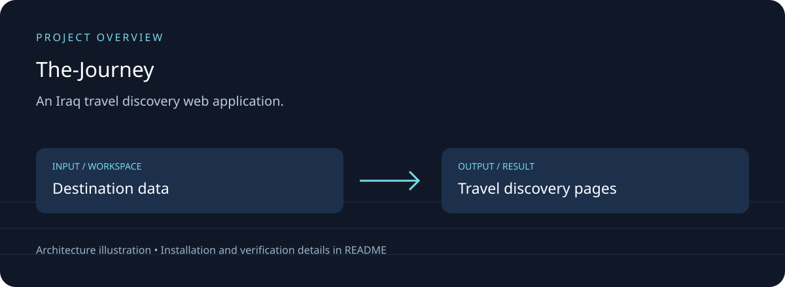

# The Journey — الرحلة

## Download, setup and project overview

An Iraq travel discovery web application.

Map-based exploration; destination pages; source checks; data refresh scripts.



[Download source ZIP](https://github.com/ahpa5246-lgtm/The-Journey/archive/refs/heads/main.zip) · [Changes and branches](https://github.com/ahpa5246-lgtm/The-Journey/branches) · [Verification notes](docs/QUALITY_REVIEW.md)

The ZIP contains source code. Installation steps and external runtime requirements are listed below.

```bash
git clone https://github.com/ahpa5246-lgtm/The-Journey.git
cd The-Journey
```

From the repository directory:

```text
npm install
npm run dev
```

The diagram is a project illustration. Test results and runtime limitations are recorded in [the review](docs/QUALITY_REVIEW.md); it is not a production-readiness certification.


An Iraq-first tourism and local discovery platform for international visitors and people living in Iraq.

The product begins with one cinematic first-visit sequence, then becomes a practical bilingual discovery interface: curated heritage, an interactive governorate map, travel essentials, an explainable trip finder and opt-in creator trails.

## Why this architecture

The goal is not to pretend Iraq has no online data. The problem is that useful information is fragmented, uneven in quality and rarely presented with Iraq-specific context. The Journey separates **discovery breadth** from **editorial trust**: open data creates candidates, while published listings retain sources and review state.

## Stack

- Next.js 16 + React 19 + TypeScript
- MapLibre GL through `react-map-gl`
- OpenFreeMap for the normal discovery basemap (no product API key required)
- OpenStreetMap / Overpass for candidate place discovery
- Iraq governorate boundaries from `tawfek/Iraqi-Cities-and-Districts-data`
- GitHub Actions for data refresh and source-health checks

## Run locally

```bash
npm install
npm run dev
```

Then open `http://localhost:3000`.

Validation:

```bash
npm run typecheck
npm run build
```

## Data pipeline

Refresh the OpenStreetMap candidate queue:

```bash
npm run data:refresh
```

Candidates are written to `public/data/osm-candidates.json` with `verified: false`. They are a review queue, not automatic endorsements.

The scheduled workflow `.github/workflows/data-refresh.yml` refreshes candidates and checks tracked official sources twice per week.

## Source policy

Current curated heritage seeds use the UNESCO World Heritage Centre. Entry/visa information should link to the Iraqi Ministry of Interior's current e-Visa service rather than duplicating changing requirements.

"Verified" means the listing's identity/details were reviewed against a source. It does **not** mean The Journey guarantees personal safety.

## Creator trails

Creators submit their own profile/video links and permitted thumbnail/preview metadata. The site should send the primary click to the original platform rather than re-hosting video.

## Revenue policy

The platform can support premium business profiles, referral/booking revenue, disclosed creator campaigns and clearly labeled sponsored placement. Payment and editorial verification stay separate.

## Data credits

- UNESCO World Heritage Centre — Iraq state-party records.
- © OpenStreetMap contributors, ODbL 1.0, when candidate data is refreshed through Overpass.
- Iraq governorate/city dataset: `tawfek/Iraqi-Cities-and-Districts-data`, CC BY 4.0. A local copy of the simplified ADM1 GeoJSON is used with attribution.
- OpenFreeMap / OpenStreetMap attribution remains visible in the interactive map.

See [`docs/PRODUCT_ARCHITECTURE.md`](docs/PRODUCT_ARCHITECTURE.md) for the product, trust, automation, monetization and performance decisions.

## Visual-content note

The first code pass uses designed illustration placeholders for the cinematic triptych. Replace them with Iraq-specific photography only when the team has a clear license/permission and attribution record for each image.
